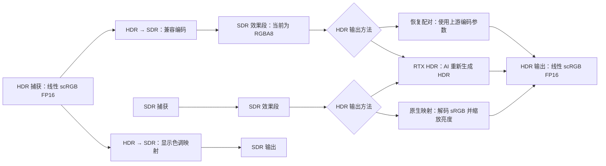
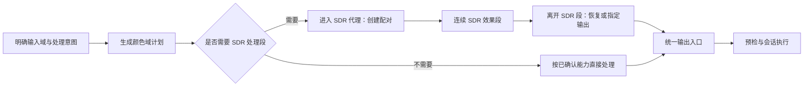
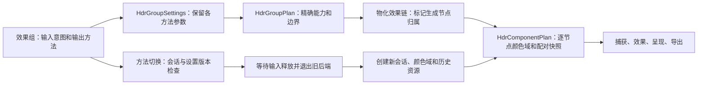

# HDR 兼容模式更新功能文档

2026-10-09 试用后调整：HDR 兼容改由用户手动组装独立效果器，撤回组级统一输入／输出入口及自动管理。其余更新保留，当前需求见[手动组装调整 TODO](../todos/20261009-hdr-manual-chain-adjustment-TODO.md)。下文的组级入口与管理方案保留为上一轮设计和实现记录。
2026-10-09 源码调整及独立回归已完成，当前实现和后续验收见[手动组装开发交接](20261009-hdr-manual-chain-implementation.md)。

日期：2026-10-05。状态：首轮源码实现及针对性回归完成，见[开发需求与交接](../todos/20261005-hdr-compatibility-update-development-TODO.md)。目标版本尚未指定；完整构建、部署和实机验收交给后续会话。

本文汇总 HDR → SDR、SDR → HDR 和 RTX HDR 的检查基线、已验证问题、交互合并方案、参数范围与步进建议，以及实施和验收要求。检查基于本地源码与生产代码探针。2026-10-05 已授权在独立功能分支开发；本会话进行源码与针对性回归，应用完整编译和部署交给后续独立会话。下文“当前实现”描述检查基线，更新后的状态以开发进度为准。

## 1. 更新目标与实施范围

让用户围绕“输入是什么、效果如何处理、最后输出什么”配置 HDR，减少手动放置转换效果器、重复设置同一参数和理解内部颜色格式的成本。

首轮更新覆盖以下内容：

1. 修复 HDR 截图／导出的格式处理、RTX HDR 销毁失败反馈和无效参数显示。
2. 分离参数合法精度、手动输入精度与交互步进，保留旧配置和默认值。
3. 合并原生 SDR → HDR 的白色亮度与曝光，允许用户设置 1000、1500 等更高亮度。
4. 将 SDR → HDR 与 RTX HDR 整理为同一个逻辑“HDR 输出”入口，按方法显示有效参数。
5. 在效果组提供 HDR 兼容处理管理，自动组织经过确认的 SDR 处理段所需的前后转换，保留手动链。
6. 同步效果器说明、参数文案、配置迁移和回归／实机验收。

FP16 SDR 代理、广色域保护、原始 HDR 残差保留和新的非 AI 高光扩展曲线列为后续画质研究。它们尚未形成可交付算法，不作为首轮已解决事项。

## 2. 当前功能与实现路径

### 2.1 链路如何决定捕获与输出

当前使用显式转换组件与逐节点颜色域计划；旧配置页的 HDR 开关保持隐藏和关闭。第一个被识别的转换组件决定捕获域：HDR → SDR 要求 HDR 捕获；SDR → HDR 或 RTX HDR 要求 SDR 捕获。普通效果继承当前颜色域，最后的节点域决定 HDR 输出。

Windows 开启 HDR、捕获纹理为 FP16，都不足以单独证明源应用正在输出原生 HDR。新入口必须明确处理意图，不能据此自动判断内容并套用转换。

上图列出当前合法路线，不代表可以把几个输出方法串联。RTX HDR 接收 SDR；不能先普通 SDR → HDR，再将 HDR 送给 RTX HDR。已有多个独立合法转换对可以保留。

### 2.2 各组件实际做什么

| 组件／方法 | 当前功能 | 重要限制 |
| --- | --- | --- |
| HDR → SDR：兼容配对 | 按 RGB 通道进行峰值归一化对数压缩，再编码到 sRGB，产生 SDR 代理与配对参数 | 当前中间存储为 RGBA8；负通道和超过声明峰值的值会被截断 |
| HDR → SDR：SDR 显示映射 | 按亮度进行肩部压缩，再编码为 SDR | 不生成可恢复配对；当前 `peakNits` 不参与此分支计算 |
| SDR → HDR：自动 | 有兼容配对时恢复；没有时使用原生 SDR 白色映射 | 两种情况的参数含义不同，界面需解释当前实际方法 |
| SDR → HDR：恢复配对 | 使用上游同一组白点、峰值、曝光、肩部参数进行逆变换 | 不等于恢复被量化、截断或被效果器修改的原始信息 |
| SDR → HDR：原生映射 | 解码 sRGB，乘以白色亮度与曝光，写入线性 scRGB FP16 | 等比例提高所有非零亮度，不推断物体或生成原始高光细节 |
| RTX HDR | SDR 8 位输入，经 RTX Video SDK 推理，输出 FP16 线性 scRGB | 与配对逆变换不同；需要支持的 GPU、驱动与运行库 |

三个 `.hlsl` 文件主要声明参数并标识转换节点；核心变换在 `HdrSurfaceAdapter.cpp`、`HdrComponentRuntime.h`，RTX 推理在 `RTXVideoHdr.cpp` 和私有 `RtxVideoBridge.cpp`。只修改标记 shader 的直通像素函数不会改变这些核心算法。

原生映射的当前关系为：`输出 scRGB = sRGBDecode(输入) × whiteNits × exposure / 80`。线性 scRGB 的 1.0 对应 80 尼特；“SDR 白色亮度”描述 SDR 白色代码值的映射目标，与内容峰值、显示器实际能力分开定义。

普通 DXGI HDR 呈现使用线性 scRGB／P709；XeSS FG 的最终呈现路径转换到 HDR10／PQ／Rec.2020。帧生成的实际执行与呈现边界不能按列表中的标记位置推断，自动组织转换时必须保留这些边界及帧历史语义。

### 2.3 当前准入检查

- HDR 捕获要求源显示器开启 HDR，并使用支持此路径的 Graphics Capture。
- HDR 输出要求本次选择的所有目标显示器均满足 HDR 输出条件。
- RTX HDR 检查桥接 DLL、TrueHDR 运行库，初始化时确认设备／功能支持。
- 条件不满足时明确报告原因，不自动修改 Windows HDR 设置。

上述行为需要延续到新入口。多显示器、设备不可用、显示器切换与缩放重建仍需实机验收。

## 3. 已验证问题及更新要求

### 3.1 HDR 截图／PNG 导出按 RGBA8 解释 FP16 数据

`Renderer.cpp` 的显示截图路径将数据声明为 RGBA8；效果输出导出也默认选择 PNG。实际 HDR 输出纹理可为 FP16，暂存纹理保留该格式，而 `TextureHelper::SavePng` 固定使用 32 位 RGBA。将原始 FP16 字节交给该路径会错误解释颜色与透明度，源码格式断言也不匹配。

更新要求：以实际纹理格式驱动读回与导出。标准 PNG 先将 HDR 映射到明确的 SDR 显示结果，再编码为 RGBA8；SDR 原路径保持正常。DDS 等中间格式保留真实像素格式。若后续增加 HDR 文件格式，应另行定义格式、元数据与查看器兼容性，不能仅把现有 PNG 称为 HDR 导出。

RTX HDR 已生成的输出不能在导出时再次执行标记 shader 或重复推理；保留现有导出保护。截图是否包含覆盖层等产品行为沿用现有定义。

### 3.2 RTX HDR 销毁时忽略 SDK 普通失败返回

`RtxVideoBridge.cpp::DestroyImpl` 未处理 `ReleaseFeature`、`DestroyParameters`、`Shutdown1` 的失败返回。导出销毁函数在没有 SEH 异常时可返回成功，导致外层已有的故障保护未触发。

使用实际销毁代码与模拟 SDK 返回值验证：三个调用都返回失败时，仍出现 `faulted=false`、用户计数归零、活动设备清空。此证据确认普通错误被吞掉；没有诱发真实驱动故障，不能据此宣称已复现或解决驱动崩溃。

更新要求：传播失败状态，记录失败阶段与 SDK 结果；按失败时仍可能持有的资源定义清理策略。运行库进入故障状态后，沿用保留故障模块和阻止不安全重初始化的保护，必要时提示重启程序。保留串行生命周期与 SEH 防护，并验证部分成功、普通失败、异常三类路径。

### 3.3 SDR 显示映射暴露无效峰值参数

生产 shader 的 SDR 显示映射分支未使用 `peakNits`。WARP 探针将该参数从 400 改到 4000，全部 1025 个输出像素相同。

首轮在这个方法下隐藏或禁用峰值参数，并清楚显示实际有效参数。兼容配对模式继续保留峰值。若以后让峰值参与显示算法，应视为新的画质行为，独立设计与验证。

### 3.4 `STEP` 同时控制交互与合法值取整

`EffectParameterValue::Normalize` 当前按 `MIN + round((value-MIN)/STEP) × STEP` 取整；手动输入、界面初始化及保存更新会受影响。直接把 `//!STEP` 改为 5、10 或 50，会改变可保存的值。

| 输入／最小值 80 | STEP=1 | STEP=5 | STEP=10 | STEP=50 |
| --- | ---: | ---: | ---: | ---: |
| 203 | 203 | 205 | 200 | 180 |
| 1000 | 1000 | 1000 | 1000 | 980 |
| 1500 | 1500 | 1500 | 1500 | 1480 |

因此先实现精度与交互步进分离，再调整交互步进。不得以更粗的滑块刻度重写默认值或旧配置。XAML 当前数值为只读显示，增加可编辑数值框属于本轮新增功能；实时 ImGui 的输入路径也必须执行同一套精度和范围规则。

### 3.5 当前兼容配对有量化、峰值截断和广色域损失

生产 shader 在 D3D11 WARP 上、效果段不修改像素时测得：

| 输入样本 | 当前结果 | 含义 |
| --- | --- | --- |
| 中性 203 尼特 | SDR 代码 168，恢复约 204.375 尼特 | 单纯往返已有 8 位量化误差 |
| 中性 800 尼特 | SDR 代码 243，恢复约 796.875 尼特 | 高亮往返也存在量化误差 |
| 中性 1500 尼特、声明峰值 1000 | 恢复约 999.375 尼特 | 编码时超出峰值的信息已被截断 |
| 广色域红色 scRGB `[4.2135,-0.316047,-0.0460577]` | 约 `[4.23828,0,0]` | 兼容编码截去合法负通道，造成颜色变化 |

FP16 捕获本身保留这些负值，损失发生在当前兼容边界。中间效果进一步改变 SDR 代理后，逆变换也无法撤销其修改。首轮修正文案与参数语义，不承诺无损恢复或任意 AI 效果都能正确处理 HDR；高精度和广色域改进见第 9 节。

## 4. 从第一性原理合并功能

### 4.1 围绕三个决定组织入口

用户需要决定的是输入处理域、普通效果是否需要 SDR 代理，以及最后采用哪种输出方法。HDR／SDR 转换组件、配对参数与 SDK 格式是实现这三个决定的内部手段。

建议在现有效果组内提供“输入／兼容处理”与“输出方法”两个逻辑部分，沿用相邻控件样式和布局。避免要求基础用户分别添加入口转换、出口转换，再手动同步白点与曝光。

“HDR 兼容模式”指让 HDR 输入通过需要 SDR 的效果段后输出指定颜色域；“SDR 转 HDR”则是输出选择。二者可以共享入口，但不能共享含义不一致的参数。

### 4.2 效果组管理前后转换

| 使用意图 | 计划行为 |
| --- | --- |
| HDR 输入，经 SDR 效果，保留 HDR 输出 | 自动创建兼容配对、共享同一组参数，处理结束后恢复 |
| SDR 输入，经普通效果，输出 HDR | 不插入 HDR → SDR；只在出口使用原生映射或 RTX HDR |
| HDR 输入，最终观看 SDR | 使用 SDR 显示映射并保持 SDR 输出；不放置恢复节点 |
| HDR 输入，使用 RTX HDR 重新生成输出 | 先生成有效 SDR 输入，再使用 RTX HDR；界面说明原始 HDR 被重新解释 |
| 已确认可直接处理 HDR 的效果段 | 保持 HDR 域，避免不必要的往返 |
| 现有复杂手动链 | 保留节点顺序和独立配对，进入高级手动编辑 |

实施规则：

- 自动处理必须依赖明确的组件／后端能力信息。“继承 HDR 域”不等于效果算法已验证支持 HDR，未知能力不能直接标成 HDR 兼容。
- 对连续且能力明确的 SDR 段合并边界；不得跨越时域历史、缩放／空间变换、帧生成或 SDK 生命周期边界擅自重排。
- 编码与逆变换共享配对标识和不可变参数快照。运行中修改配对参数时同步重建所需状态，不能只改解码端。
- 基础界面显示实际输入、处理段与输出摘要；自动生成节点由组设置管理，避免与手动节点同时生效。
- 保留高级手动组件。转换到手动编辑时保留完整计划与值；再次转为组管理时，只有能等价表达的链才可自动接管。
- “保持现有链”作为兼容入口；原生 HDR 内容判定尚不可靠时由用户明确选择输入意图，不引入猜测式自动转换。

上述功能合同已落地为效果组设置、精确效果 ID 能力表、带归属的转换节点及逐节点颜色计划。源码和针对性回归状态见第 11 节；原生界面与真实 GPU 验收仍待后续会话。

### 4.3 合并为统一“HDR 输出”入口

| 方法 | 有效参数与行为 |
| --- | --- |
| 自动 | 有有效配对时恢复，否则原生 SDR 白色映射；显示实际采用的方法 |
| 恢复兼容配对 | 显示配对来源与共享设置，不重复要求输入白点／曝光；缺少配对时报错 |
| 原生 SDR 白色映射 | 一个“SDR 白色亮度”参数；允许高亮度设置 |
| RTX HDR | 峰值亮度、对比度、饱和度、中间灰；显示支持状态 |

入口统一，后端算法仍分别执行。切换方法时保存未激活方法的参数，切回后恢复；不因原生亮度较高而自动改用 RTX，也不在 RTX 不可用时静默换算法。

支持实时修改的标量参数按现有路径即时应用。方法切换涉及颜色域、资源或 SDK 变化时，使用现有安全的会话重建流程并向用户说明生效时机，不能承诺无缝切换。

## 5. 原生 SDR → HDR 范围与参数合并

### 5.1 允许 1000／1500 的建议合理，但参数不是峰值限制

当前原生 `whiteNits` 范围为 80–400，独立 `exposure` 为 0.1–4。400 是白色参数上限，不是整条 HDR 输出的峰值上限；现有两个参数组合已可得到 1600 尼特的 SDR 白色映射。

支持开放 1000、1500 等用户设置，建议合并为：**SDR 白色亮度，80–4000 尼特，默认 203**。这是一项面向原生映射的产品范围建议，不是 SDK 上限或显示器能达到的保证。RTX 峰值继续遵守当前 SDK 的 400–2000。

合并后的参数等于旧 `whiteNits × exposure`，新配置只保留一个有效亮度，不再额外乘一个最高 4 倍的原生曝光。HDR → SDR 的曝光、肩部属于压缩算法，继续放在其进阶设置中。

### 5.2 高亮度对画面的影响

原生映射保留线性比例，所以白色、灰色、字幕和高光都会一起提高。以中性 SDR 白色 255 与代码 128 为例：

| SDR 白色亮度 | 白色输出目标 | 代码 128 的输出亮度，约 |
| --- | ---: | ---: |
| 203 | 203 尼特 | 44 尼特 |
| 1000 | 1000 尼特 | 216 尼特 |
| 1500 | 1500 尼特 | 324 尼特 |

高值本身不构成算法错误；实际观感取决于内容与显示器。设备可能色调映射、压缩高光或触发亮度限制，结果不一定等同于参数值。它也不会恢复 SDR 中已丢失的高光纹理。

交互采用明确标签和轻量说明，例如“SDR 白色将映射到 1500 尼特，整体画面会随之变亮”。提供 203 默认值与恢复默认操作，允许用户自行比较原生映射和 RTX HDR；不增加高值确认弹窗，不强制按显示器峰值截断用户偏好。

显示器能力可作为参考信息或用户主动采用的建议值；不得把测得能力当成原生内容峰值，或在读取旧配置时自动覆盖保存值。

### 5.3 迁移必须保留低曝光旧值

旧参数组合的有效范围为 8–1600 尼特，不仅是 80–1600。新字段下限 80 不能把旧 `80 × 0.1 = 8` 抬到 80。

- 读取旧配置保持原语义；8–80 以下旧值保留可表示状态，可使用兼容字段或旧原始参数路径。
- 用户明确按新界面设置时才进入新的 80–4000 范围；加载、打开参数窗、保存其他设置不能隐式改变亮度。
- 旧原生映射、自动模式无配对、自动模式有配对分别迁移，不能统一替换为白色映射。
- 合并时同时核对输出颜色合同、DLSSNR 白点归一化和 FG 呈现参数；像素乘法等价不足以证明整条链等价。
- 不改变兼容配对的逆变换参数来实现输出增亮。若将来提供恢复后的独立亮度调整，应明确放在逆变换之后。

## 6. 参数范围、精度与步进建议

### 6.1 建议表

以下值是首轮交互建议：基于当前算法范围、SDK 合同和典型调节尺度，不代表经过用户盲测的唯一最优值。亮度单位为尼特，曝光／肩部为无量纲倍率，RTX 三个画面参数沿用 SDK 单位。

| 参数 | 建议范围 | 默认值 | 普通步进 | 粗调步进 | 输入／保存精度 |
| --- | --- | ---: | --- | ---: | --- |
| 原生映射：合并后的 SDR 白色亮度 | 80–4000；低于 80 的旧值兼容保留 | 203 | 5／10／50，分段 | 50 | 新输入 1 尼特；旧值不重取整 |
| HDR → SDR：参考白色亮度 | 80–400 | 203 | 5 | 50 | 新输入 1 尼特；旧值不重取整 |
| HDR → SDR：兼容编码峰值 | 400–4000 | 1000 | 10 | 50 | 新输入 1 尼特；旧值不重取整 |
| RTX HDR：峰值亮度 | 400–2000 | 1000 | 10 | 50 | 整数 1 |
| RTX HDR：对比度 | 0–200 | 100 | 5 | 10 | 整数 1 |
| RTX HDR：饱和度 | 0–200 | 100 | 5 | 10 | 整数 1 |
| RTX HDR：中间灰 | 10–100 | 50 | 1 | 5 | 整数 1 |
| HDR → SDR：曝光 | 0.1–4 | 1 | 0.05 | 0.25 | 新输入 0.01；旧值不重取整 |
| HDR → SDR：肩部 | 0.1–4 | 1 | 0.05 | 0.25 | 新输入 0.01；旧值不重取整 |

SDR 显示映射下不显示兼容编码峰值。恢复配对下不显示另一套独立白点、曝光或肩部。RTX 输出下不展示原生白色亮度。

### 6.2 原生白色亮度的分段步进

| 当前调节区间 | 普通步进 | 理由 |
| --- | ---: | --- |
| 80–400 | 5 | 常用参考白附近需要细调 |
| 400–1000 | 10 | 平衡调节次数与控制粒度 |
| 1000–4000 | 50 | 高值范围更大，单次 1 尼特意义有限 |

端点必须可到达；跨 400／1000 边界不能出现往返跳变、卡住或只能单向到达的值。大范围滑块可采用非线性位置分配，给 80–400 足够长度；这只改变滑块坐标，不改变像素亮度映射公式。

### 6.3 交互合同

- 数字输入按合法范围和输入精度校验；整数参数拒绝或明确转换小数，错误反馈就近显示。
- 数值字段可输入 203、1000、1500、4000；提交、失焦、重新打开、保存／重载后不因粗步进改变。
- 保存精度与滑块普通步进、粗调操作分别定义。仅操作相关的交互控制时才应用交互刻度。
- 刻度使用合理绝对网格，并单独支持最小值、最大值和默认值；不能沿用 `MIN + k × 50` 导致 1000 变 980。
- 非网格值开始拖动或步进时，采用方向一致的下一可达刻度规则；203 作为默认值始终可恢复，未经操作不吸附。
- XAML 参数编辑、实时 ImGui、键盘／滚轮及保存路径遵循同一合法值规则。粗调映射沿用已有输入约定，若无统一约定，再在实现中确定并说明。
- 显示单位与小数位一致；倍率默认 1 可显示为 1.00，RTX 中间灰不能误标成百分比或尼特。
- 新精度与步进机制对本轮 HDR 参数启用；其他效果的旧 `STEP` 合同保持兼容，避免全局修改造成额外迁移。

## 7. 配置、运行状态与失败行为

1. 新组管理配置与手动组件链有明确所有权；启动前生成唯一颜色域计划，不让两套节点重复执行。
2. 旧手动链、多个合法配对和未激活方法参数完整保留。含混合、重复、特殊节点的链不能强行转换到基础入口。
3. 旧 HDR 开关不重新启用。新的组设置通过颜色域计划决定捕获与输出，不依赖旧布尔值偷偷启用另一条路径。
4. 缺失配对、非法颜色域、SDK 不支持、运行库缺失和显示器 HDR 条件不足应有可定位的说明，保留用户原设置。
5. 切换方法、重建、停止与失败退役须保持帧历史和资源所有权一致。RTX 清理失败进入故障保护，不能以保存配置成功掩盖运行失败。
6. 参数快照、输出格式、导出、DLSSNR 白点、FG 输入与最终呈现按同一会话计划运行，避免某个消费者继续使用旧颜色合同。

## 8. 实施顺序与验收

### 8.1 执行顺序

- [x] 阶段 1：确认执行起点与工作区现有改动；建立格式／参数合同回归，修复截图格式、RTX 清理返回值和无效参数。
- [x] 阶段 2：加入精度与交互步进分离，贯通 XAML／ImGui／持久化；实现原生白色参数合并与 80–4000 范围，保留低于 80 的旧语义。
- [x] 阶段 3：统一 HDR 输出入口、方法参数保留和条件显示；保留现有手动链并验证切换／重建行为。
- [x] 阶段 4：效果组管理配对与 SDR 段，明确能力信息、计划所有权、时域与 FG 边界；完成复杂链迁移策略。
- [x] 阶段 5：同步效果目录生成、说明与语言资源，完成针对性源码检查与自动回归，记录剩余实机验收。
- [ ] 后续实机：原生 UI、真实显示器、RTX 推理、游戏／视频、画质、性能与 FG 联动分别验收；完整构建、发布版本和部署范围在执行时按后续指令确定。

实施项的源码和回归进度见开发记录。既有源码／探针通过不能替代更新后的验证，也不构成 Release 或硬件验收。

### 8.2 功能验收矩阵

| 场景 | 必须满足的结果 | 验证层级 |
| --- | --- | --- |
| SDR → 原生 HDR，203／1000／1500／4000 | 数值精确保存，像素符合原生映射关系，输出为正确 HDR 域 | CPU／WARP，随后真实显示器 |
| 旧白色 80、曝光 0.1；旧 400、曝光 4 | 保持原有效 8／1600；加载与保存不改亮度 | 配置回归、渲染回归 |
| 合法手动配对、多个独立配对 | 顺序、配对身份和原结果保持；基础入口不强行接管 | 计划／渲染回归 |
| 自动：有配对／无配对 | 分别恢复／原生映射；文案、参数与实际方法一致 | 模型、UI、渲染 |
| 恢复配对但缺少有效入口 | 定位错误，不临时改用其他算法 | 计划／原生 UI |
| SDR 显示映射 | 无无效峰值控件，已有有效参数继续正确作用 | WARP、UI |
| 普通／粗调、非网格值、边界 | 203 不被初始化取整；1000／1500 可达；跨区间双向一致 | 参数模型、XAML、ImGui |
| 方法来回切换及缩放重建 | 各方法值保留；资源、历史与颜色合同同步 | 会话回归、真实 RTX |
| RTX 支持／不支持／缺库 | 按支持状态执行或报具体原因，不静默改变用户方法 | 模拟合同、真实设备 |
| RTX 清理部分失败／全部失败／SEH 异常 | 返回与日志反映失败；资源和故障模块处理安全，阻止不受控重初始化 | 故障注入、实际生命周期 |
| HDR 截图、效果输出、SDR 截图 | 标准 PNG 是正确 SDR 编码；无 FP16 字节误读；不重复 RTX 推理 | 导出回归、查看器实测 |
| HDR／SDR、缩放、DLSSNR、XeSS FG | 尺寸、alpha、白点、域与呈现合同正确，时域不因自动节点重排受损 | 既有回归、真实 GPU／FG |
| 多显示器、DPI、切换／停止 | 预检、输入焦点、数值编辑和安全退役正确 | 原生 UI／硬件 |

画质验收采用中性灰阶、极亮高光、字幕／UI、饱和广色域颜色、暗场、游戏与视频。分别记录信号值、显示器状态与主观结果；不能用 WARP 结果认定真实屏幕观感、推理效果、延迟或性能合格。

## 9. 后续画质研究

### 9.1 高精度 SDR 代理与广色域保护

评估允许的效果后端能否使用 FP16 SDR 代理，减少 8 位往返量化；需要 8 位输入的模型仍有量化边界，不能把升级格式视为全链无损。广色域方案需处理合法负 scRGB 与色域映射，不能仅对每通道夹到零。

保留原 HDR 或残差可作为研究方向，但效果段可能缩放、锐化、改变空间内容或具有时域状态。必须解决源／输出尺寸、空间对应、帧身份和残差融合，不能直接把旧残差加回任意输出。

### 9.2 非 AI 高光扩展

可研究将参考白与目标峰值分开、主要扩展高亮区域的曲线，以减少中间调随峰值整体抬升。但相同 SDR 像素值可能是纸张、字幕或太阳，单一曲线无法判断语义，也无法找回已丢失细节。

此方法若成立，作为新增输出方法与原生比例映射、RTX HDR 并列；定义中间调、肩部、色域和时域稳定性后再提出范围／默认值，不复用“白色亮度”冒充独立高光峰值。

## 10. 检查证据与实施定位

### 10.1 本地证据

检查起点 HEAD 为 `13adddb6816ecf25cc80b043f0b2f9e0351cb297`，工作区另有未提交改动；后续执行须重新核对。此轮已通过既有 HDR CPU／机械回归、Bicubic SDR／HDR 缩放与缓存、组件边界、生产 shader WARP 和组件计划检查；桥接 ABI 检查覆盖无效／空参数，没有进行 NGX 推理。

任务证据位于仓库外的工作区 `evidence/hdr-audit-20261005`，以下链接指向原始工作区的绝对路径，可从本功能工作目录打开：

- [生产 shader WARP 结果](<C:/Users/81443/Documents/Magpie enhance/evidence/hdr-audit-20261005/audit-warp-results.txt>)：9 条 FP16／RGBA8 组件路线、54 个渐变／往返样例，以及量化、截断、广色域和无效峰值探针。
- [RTX 清理失败探针](<C:/Users/81443/Documents/Magpie enhance/evidence/hdr-audit-20261005/audit-rtx-cleanup-results.txt>)：实际销毁代码配合模拟 SDK 失败返回。
- [生产参数取整探针](<C:/Users/81443/Documents/Magpie enhance/evidence/hdr-audit-20261005/step-grid-results.txt>)：203／1000／1500 在不同 `STEP` 下的变化。
- [探针准备脚本](<C:/Users/81443/Documents/Magpie enhance/evidence/hdr-audit-20261005/prepare_audit_probes.py>)与[参数探针源码](<C:/Users/81443/Documents/Magpie enhance/evidence/hdr-audit-20261005/step-grid-probe.cpp>)。
- [链路可视化预览](<C:/Users/81443/Documents/Magpie enhance/evidence/hdr-audit-20261005/visual-preview.html>)与[浏览器验证结果](<C:/Users/81443/Documents/Magpie enhance/evidence/hdr-audit-20261005/visual-check.json>)：四种路线、样本数值和窄屏布局；用于解释机制，不模拟实际 HDR 显示器或 RTX 推理。

未完成：真实 Magpie HDR 捕获／输出、原生参数 UI、真实 RTX Create／Evaluate／Destroy、显示器观感与性能、游戏／视频与 FG 验收。安装包内三个标记 shader 与源码哈希相同，只能证明对应文件相同，不能证明 C++ 二进制等价。

### 10.2 主要代码与历史资料

| 责任 | 实施定位 |
| --- | --- |
| 组件识别、颜色域与配对计划 | [HdrComponents.h](../../../src/Magpie.Core/include/HdrComponents.h)、[ScalingWindow.cpp](../../../src/Magpie.Core/ScalingWindow.cpp)、[Renderer.cpp](../../../src/Magpie.Core/Renderer.cpp) |
| 实际颜色变换与配对参数 | [HdrSurfaceAdapter.cpp](../../../src/Magpie.Core/HdrSurfaceAdapter.cpp)、[HdrComponentRuntime.h](../../../src/Magpie.Core/HdrComponentRuntime.h)、[HdrColorTransform.cpp](../../../src/Magpie.Core/HdrColorTransform.cpp) |
| RTX 推理／私有桥接生命周期 | [RTXVideoHdr.cpp](../../../src/Magpie.Core/RTXVideoHdr.cpp)、[RtxVideoBridge.cpp](../../../src/RtxVideoBridge/RtxVideoBridge.cpp) |
| HDR 预检与图片导出 | [HdrDisplayPreflight.h](../../../src/Magpie.Core/HdrDisplayPreflight.h)、[TextureHelper.cpp](../../../src/Magpie.Core/TextureHelper.cpp)、Renderer 导出路径 |
| 参数合法值、编辑与实时面板 | [EffectParameterValue.h](../../../src/Magpie.Core/include/EffectParameterValue.h)、[EffectParametersViewModel.cpp](../../../src/Magpie/EffectParametersViewModel.cpp)、[ScalingModesPage.xaml](../../../src/Magpie/ScalingModesPage.xaml)、[OverlayDrawer.cpp](../../../src/Magpie.Core/OverlayDrawer.cpp) |
| 参数声明、选择器说明 | [HDR_to_SDR.hlsl](../../../src/Effects/Color/HDR_to_SDR.hlsl)、[SDR_to_HDR.hlsl](../../../src/Effects/Color/SDR_to_HDR.hlsl)、[RTXVideo_HDR.hlsl](../../../src/Effects/RTXVideo/RTXVideo_HDR.hlsl)、[hdr-components.json](../../../src/Magpie/EffectCatalog/hdr-components.json)、[目录生成脚本](../../../scripts/Generate-EffectCatalog.ps1) |
| 回归入口 | [Run-HdrRegression.ps1](../../../scripts/Run-HdrRegression.ps1)、[Run-HdrComponentsTests.ps1](../../../tests/Run-HdrComponentsTests.ps1)、[rtx_hdr_bridge_abi.py](../../../tests/rtx_hdr_bridge_abi.py) |

历史行为参考[HDR 组件实施记录](../reviews/20260908-v0.6.7-hdr-conversion-effects-plan.md)。后续实施以当前源码为准，不能用历史状态替代当前检查。

### 10.3 调研依据与建议边界

- 当前本地 [RTX Video SDK 1.1 编程指南](<C:/Users/81443/Documents/Magpie enhance/dependencies/RTX-Video-SDK-1.1.0/NVIDIA_RTX_Video_SDK_Programming_Guide.txt>)规定 MaxLuminance 400–2000、默认 1000，及现有三个画面参数范围；RTX 上限按此合同保留。
- [Microsoft：HDR 与高级颜色](https://learn.microsoft.com/en-us/windows/win32/direct3darticles/high-dynamic-range)用于区分 scRGB 信号、参考白与显示器能力。203 默认值保留当前产品设置。
- [Microsoft：Slider 设计](https://learn.microsoft.com/en-us/windows/apps/develop/ui/controls/slider)支持滑块配合精确数值输入的设计；本文具体步进是针对本产品的判断，并非文档规定值。
- [NVIDIA RTX Video SDK](https://developer.nvidia.com/rtx-video-sdk)说明 AI 转换方法；[Maxine TrueHDR 参数文档](https://docs.nvidia.com/maxine/vfx/latest/Filters/TrueHDR.html)仅作参数语义对照，不能用另一套 API 的默认值或输出格式替换当前 NGX 集成。

原生上限 4000、分段步进与入口合并为待实施建议；SDK 合同、当前算法行为与生产探针结果为检查结论。文档不把建议写成现有功能或已完成验收。

## 11. 首轮源码实现与可视化

本次开发位于 `feature/hdr-compatibility-update`，基础修复提交为 `5eadefb8`。完整构建、应用链接、Release 与部署不在本会话范围；以下“通过”指对应源码或独立测试，不能视为实机验收。

- `HdrGroupSettings.h` 保存输入、输出方法以及输入、原生、RTX 各自的参数。原生旧参数额外保留白色、曝光和峰值元数据。
- `HdrGroupPlan.h` 只移除有有效归属的自动节点，按明确能力生成 SDR 段；缩放、时域及 SDK 边界保持独立。末尾 FG 项保留在输出之后，中间 FG 布局交给高级手动编辑。
- `HdrEffectCapabilities.h` 由 `Generate-HdrEffectCapabilities.py` 生成，登记 159 个精确内置 ID，另三个转换组件使用专门合同。确认的直接 HDR 路线为 Bicubic、DLSS SR、FSR2/3/4 SR、XeSS SR 和 NIS；其他已登记内置效果按 SDR 处理合同组织，未知或自定义效果不被标为已确认的 HDR 路线。
- 旧手动链在加载时不自动迁移。用户选择组管理时，只有普通效果顺序、缩放、颜色域、配对及元数据都能等价表达的链才可接管；多个独立配对或不等价边界保留。进入高级手动时展开全部节点并保留明确的输入意图，进阶捕获选择允许主动改回组件决定输入。
- XAML 组设置显示摘要和实际输出方法，共享输入参数与输出参数沿用参数面板；ImGui 对生成的共享输入只显示一份，隐藏配对解码和受组管理的方法字段。方法切换保留未激活值，不自动切换 RTX。
- 新配置使用带版本的 `hdr` 设置及节点 `hdrManagedRole`。加载校验要求保存链与组设置的执行语义一致；损坏节点和原始 JSON 保留用于恢复，阻止错误启动，不静默删除或按另一种颜色域解释。可通过恢复原配置或在配置文件中修复后重载恢复，完整恢复无效组的原生交互仍需后续验收。
- 修改方法时使用完整会话重建。停止、任务切换及较新的设置请求会使旧请求失效；按键未释放时先等待。旧参数面板保存被识别为已过期请求，新拓扑使用独立参数会话。

已通过生产配置读写、组件和组计划、分段步进、导出、RTX 清理故障注入、生产会话切换调度／重建函数的隔离回归；16 个源码文件使用匹配的 WinRT 投影完成 MSVC 语法检查。生产 shader 的 WARP 验证覆盖 9 条组件路线、54 组坡度／往返以及 203、1000、1500、4000 和旧 8／1600 映射。目录与 20 个语言资源通过一致性检查。

会话回归模拟调度器、窗口和图形生命周期边界，没有执行真实 SDK、创建应用 UI 或测量 GPU/显示器。XAML 完整代码生成、应用链接、原生窗口交互、DPI、截图查看器、真实 RTX 和 FG、画质及性能仍按第 8 节交给后续会话。
